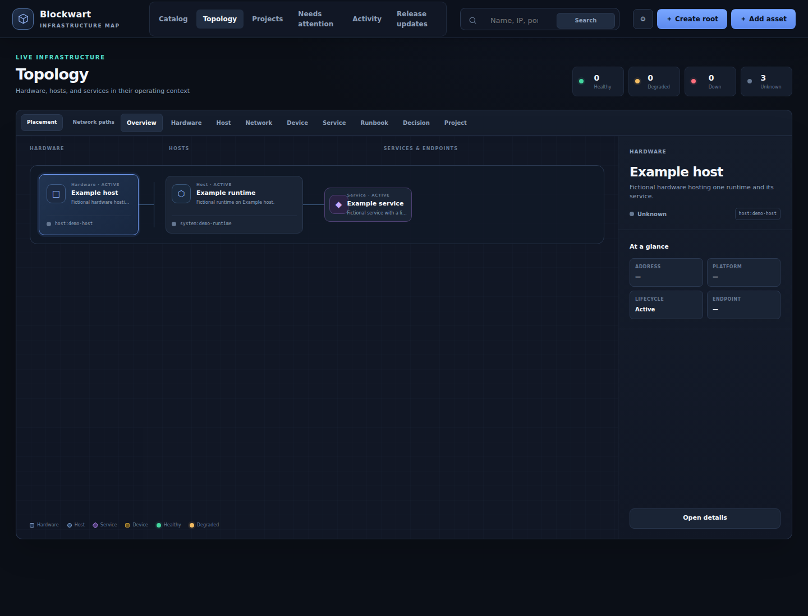
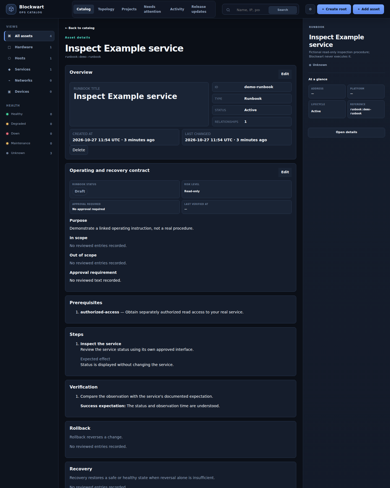

# First useful catalog

Go from a source checkout to a signed-in browser, then answer: **Where does this
service run, and how do I inspect it?** This is a local evaluation, not a production
deployment. It uses four fictional objects and does not contact any infrastructure.
For an existing instance, ask its operator for access and skip to [the tour](#4-take-the-tour).
For an agent, continue with the [agent quickstart](agent-quickstart.md).

## Before downloading

- Use a Linux machine with Git, Python **3.12 or newer** and Python venv support,
  or Git and Docker Engine with Compose v2 for the container alternative below.
  Linux is the CI target; native Windows/macOS installation is not verified here.
- Install [Caddy](https://caddyserver.com/docs/install) on that same machine for
  local HTTPS. Browser identity cookies always require HTTPS; a running container
  alone is not a usable browser trial. The example uses ports **8000** and **8443**, plus Caddy's loopback admin
  endpoint on **2019**.
- Allow dependency/image downloads, local disk for the checkout, environment and
  SQLite data, and certificate trust setup. No external database, model, GPU,
  cloud account, or paid service is required for this example.
- This is an operator-level setup: install, migrate, bootstrap an owner, seed,
  start HTTPS, sign in. Installation time and minimum RAM/disk have **not been
  benchmarked**; they depend on the host and downloads, not just the application.

Get the repository and record the exact revision:

```bash
git clone https://github.com/reisball/blockwart.git
cd blockwart
git rev-parse HEAD
```

These instructions describe this checkout. `main` may contain changes for the
**next** release, including this guide; it is not a released version claim.
For a pinned published version, select its tag from
[Releases](https://github.com/reisball/blockwart/releases) and use the docs shipped
with that tag. Release assets include Python wheels/source archives; the container
path below builds from source, not a promised prebuilt registry image.

## 1. Install and initialize (Python path)

Run these commands from the repository root. Keep this terminal open; the database
path is exported for subsequent commands. The directory is disposable evaluation
data under your temporary directory, not a production backup location.

```bash
python3.12 -m venv .venv
. .venv/bin/activate
python -m pip install --constraint requirements/runtime.txt .
export BLOCKWART_DEMO_DATA_DIR="$(mktemp -d "${TMPDIR:-/tmp}/blockwart-demo.XXXXXX")"
export BLOCKWART_DATABASE_URL="sqlite:///$BLOCKWART_DEMO_DATA_DIR/blockwart.sqlite3"
blockwart-db upgrade
blockwart-auth bootstrap-owner --login example-owner --display-name "Example Owner" --catalog-owner
blockwart-seed --seed seeds/quickstart.yaml --owner-login example-owner
```

Choose a password when prompted; it is not a command argument. The protected first
human is platform admin and global catalog owner; the seed gives that human direct
Owner grants on all four demo objects. An empty catalog cannot start: ownership and
catalog-owner readiness checks are intentional, not steps to bypass.
Expect `seed_imported objects=4 relationships=3`.

Start the application with its readiness gates and a loopback-only bind:

```bash
blockwart-db check &&
  python -c 'from blockwart.config import get_settings; from blockwart.db.readiness import check_database_readiness; check_database_readiness(get_settings())' &&
  python -m uvicorn blockwart.main:app --host 127.0.0.1 --port 8000 --no-proxy-headers
```

Leave it running. Do not substitute `blockwart-start` on the host: that launcher
binds `0.0.0.0` and has no host option. Use it only inside the loopback-published
container alternative or another deliberately configured network boundary.

### Alternative: build and initialize a container

Use this **instead of** the Python steps, in a fresh evaluation checkout with no
existing Compose data. The named volume persists across `down` and is not deleted
by the cleanup below. Keep the same checkout directory/project name for each command.

```bash
BLOCKWART_BUILD_REVISION="$(git rev-parse HEAD)" docker compose -f compose.example.yaml build
docker compose -f compose.example.yaml run --rm blockwart blockwart-db upgrade
docker compose -f compose.example.yaml run --rm blockwart blockwart-auth bootstrap-owner --login example-owner --display-name "Example Owner" --catalog-owner
docker compose -f compose.example.yaml run --rm blockwart blockwart-seed --seed seeds/quickstart.yaml --owner-login example-owner
docker compose -f compose.example.yaml up
```

The application is published on `127.0.0.1:8000`; continue with host-side Caddy.
Do not import the demo into an existing catalog. The older larger
`seeds/pilot_objects.yaml` is not needed for this tour.

## 2. Start local HTTPS

In a second terminal, from the repository root, run Caddy as your normal user:

```bash
caddy run --config examples/quickstart/Caddyfile --adapter caddyfile
```

Caddy creates a **local** certificate authority and may request permission to add
its root certificate to your trust store. If automatic installation is unavailable,
run `caddy trust` as that same user, authorize the trust-store operation when
requested, and follow Caddy's instructions for browsers with a separate trust store.
Trust only this evaluation CA; do not bypass certificate validation. Keep Caddy
running and browse on the **same machine** as the two processes.

The complete example [Caddyfile](../examples/quickstart/Caddyfile) terminates TLS
on loopback `https://localhost:8443` and proxies to the loopback application. It is not a
public-domain HTTPS/HSTS or multi-host production recipe. Automatic HTTP redirects
are disabled, so the example does not also try to bind privileged port 80. Forwarded source headers
are overwritten; Blockwart's proxy trust allowlist stays empty for this local
trial, so source limiting uses the loopback peer. Production requires the exact
[trusted-proxy and HTTPS contract](deployment.md#https-reverse-proxy-contract).

## 3. Verify readiness and sign in

A local process probe can use HTTP without browser cookies:

```bash
curl --fail http://127.0.0.1:8000/api/health/ready
```

Expect HTTP 200 and `ok: true`. This proves readiness, **not** successful login.
Open **https://localhost:8443/auth**, sign in as `example-owner` with the password
you chose, then open **https://localhost:8443/**. Use HTTPS for the whole tour.

## 4. Take the tour

UI labels below use English; the language switcher also offers German. In this
UI, **Hardware** means the catalog kind `host` (physical machine), and **Host**
means `system` (runtime such as a VM/container). The example names make that
distinction explicit.

1. In **Catalog**, search for **Example service** and open it. Its summary explains
   the example; its placement identifies **Example runtime** on **Example host**.
2. Open **Topology** (`/?view=topology`). Follow the placement chain:
   **Example host → Example runtime → Example service**. Health stays **unknown**:
   importing a record is not evidence that a real service is healthy.
3. Open **Inspect Example service** from the catalog or the service's relationship
   links. Read its purpose, inspection step, expected effect and verification.
   It is deliberately a **draft**. Blockwart stores the instruction but does not
   execute it, request a secret, or inspect your actual service.
4. Return to **Example service**, choose **Edit** in **Overview**, add a
   short note, and save. Reload and confirm your note is present. This is your
   first catalog write and readback; no infrastructure has changed.



*Where does the service run? The same four-object seed used above, in the actual UI.*



*How is it inspected? A linked, inert procedure, with separate expected effects and verification.*

### Add your own first useful knowledge

Use a separate fresh database for a real catalog, following the
[installation and ownership bootstrap](deployment.md#local-package-run). An initial
reviewed seed/import is needed before startup; do not start empty and expect the UI
to bypass ownership readiness. You can adapt a **copy** of the four-object seed
before importing, using real descriptions but no secrets, or use the
[reviewed Markdown/YAML workflow](markdown-import.md).

Within the demo, you can also practice: choose **Create root**, type **Hardware** (`host`), and
record a new physical machine with an ID, **Hostname** and **Summary**. Use **Add asset** with that host
as parent for a **Host** (`system`), then with that runtime as parent for a
**Service**. Required
fields and permitted kinds come from the current form. Create a draft Runbook
root, fill its purpose/steps/verification, and enter `service:demo-service` in
**Applies to** (replace that reference when recording your own service).
Reopen those records and confirm placement and references. The bootstrap human
has these rights; other accounts need explicit object grants/root authority.

For Projects, start at [Project workspace](project-workspace.md). Catalog search
finds catalog objects; project pages/tasks are searched **inside a selected
project**, not globally. Search is bounded and deterministic, not semantic RAG.

## Troubleshooting and cleanup

- **Certificate warning:** finish local CA trust for this browser. Do not switch
  the login URL to HTTP; Secure cookies are intentional.
- **Login does not stick:** use `https://localhost:8443`, not a different host or
  direct HTTP; check both foreground process logs for startup errors.
- **`owner_catalog_empty` / `catalog_owner_missing`:** verify all commands used the
  same database/Compose volume, that bootstrap included `--catalog-owner`, and
  that the seed import succeeded. Never weaken the readiness gate.
- **No objects for another account:** authentication does not grant catalog
  visibility. Ask the operator to check scoped grants; do not broaden access just
  to make a demo query succeed.
- **Port already occupied:** stop this attempt and choose unused application/proxy
  ports consistently in both commands and the Caddyfile; do not stop unrelated services.

Stop Uvicorn and Caddy with Ctrl-C; for containers run
`docker compose -f compose.example.yaml down`. Preserve any data you want to keep.
The Python demo database is in `$BLOCKWART_DEMO_DATA_DIR`; the container database
is in the Compose named volume. Neither is removed automatically. See
[Caddy local HTTPS](https://caddyserver.com/docs/automatic-https#local-https) for
removing its evaluation CA trust when no longer needed. For production, continue
with [deployment](deployment.md), [backups](config.md),
[configuration](config.md) and [permissions](auth-rbac.md).
